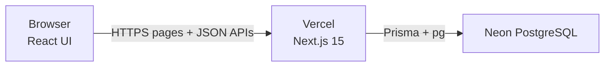
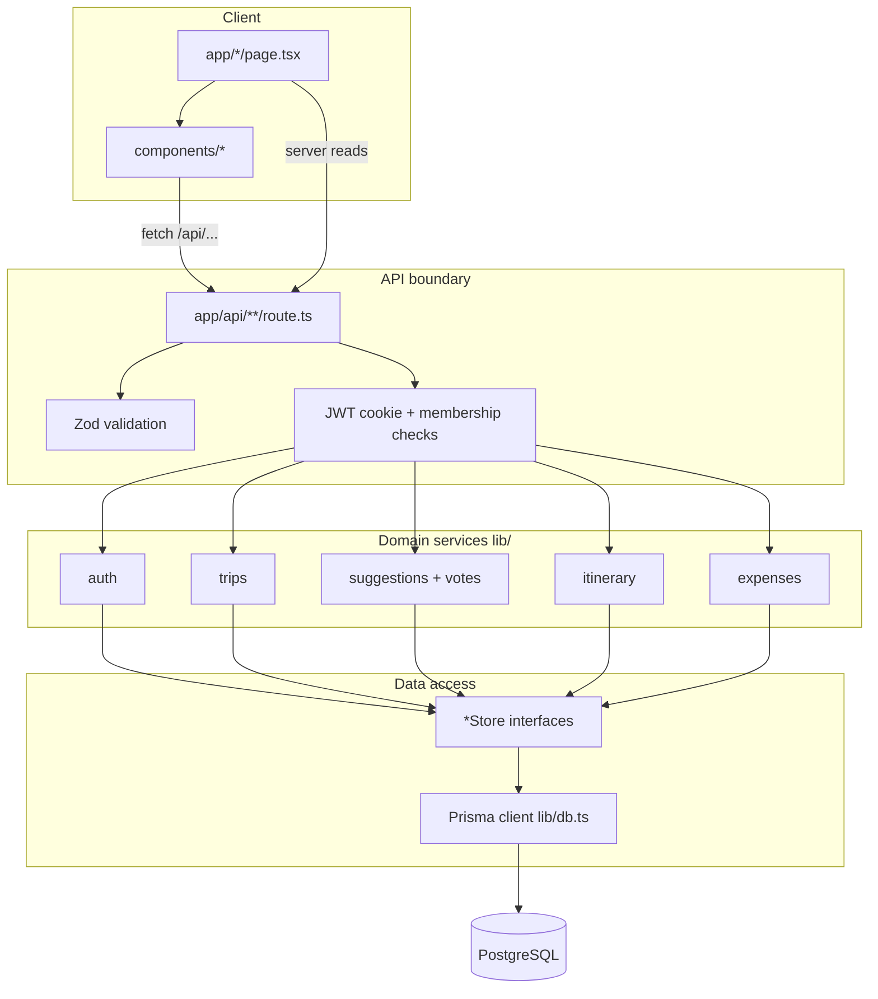
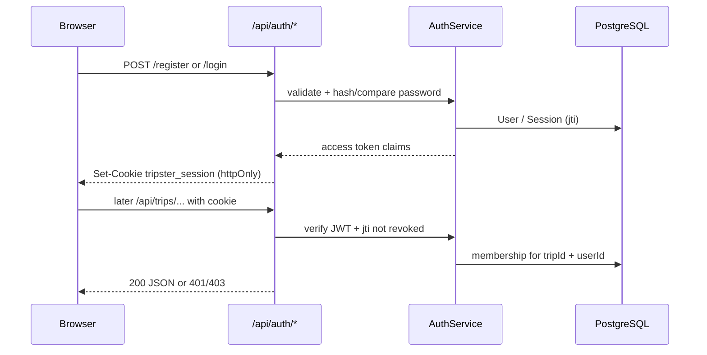
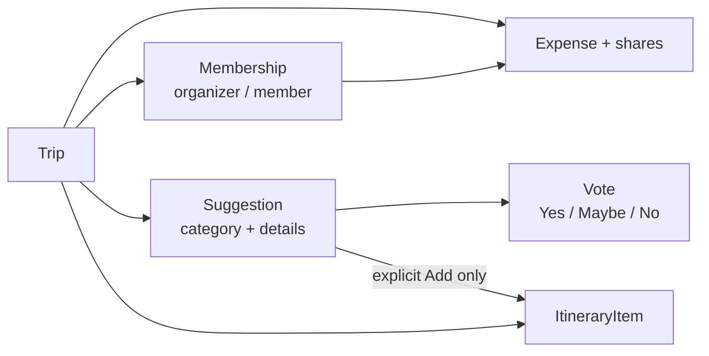
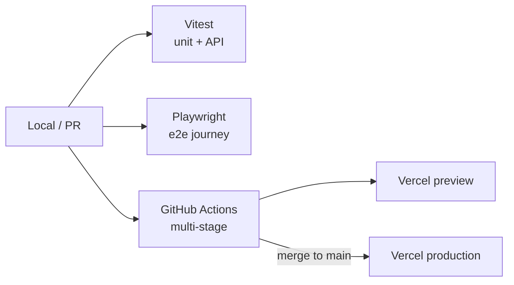

# Tripster architecture

This document describes how the Tripster full-stack app is layered, how a request moves through the system, and which domains own which rules. It matches the code on `main` (Next.js App Router, Prisma, PostgreSQL/Neon, JWT sessions).

## High-level deployment

- **Frontend and backend** run in one Next.js deployment on Vercel.
- **Pages** under `app/` render the UI; **Route Handlers** under `app/api/` expose JSON.
- **Persistence** is PostgreSQL (local or Neon). Schema and migrations live in `prisma/`.
- **CI** (GitHub Actions) typechecks, runs Vitest against Postgres, runs Playwright, security-scans, and builds before the deploy gate. Vercel handles PR previews and production deploys.

## Application layers

| Layer | Responsibility | Location |
| --- | --- | --- |
| UI | Forms, lists, trip workspace navigation | `app/`, `components/` |
| API | Parse JSON, map HTTP status, never trust client membership | `app/api/` |
| Validation | Request shapes at the boundary | Zod schemas in `lib/*/validation.ts` |
| Auth | Register/login/logout, HS256 JWT in httpOnly cookie, `jti` revocation | `lib/auth/` |
| Domain | Trip membership, votes ≠ Add, scheduling, cent-exact splits | `lib/trips`, `lib/suggestions`, `lib/itinerary`, `lib/expenses` |
| Stores | Persist behind interfaces (Prisma implementations) | `lib/*/*-store.ts` |
| Database | Users, sessions, trips, memberships, suggestions, votes, itinerary, expenses | `prisma/schema.prisma` |

Business rules stay in `lib/` services, not in React components. Trip-scoped reads and writes require an authenticated **trip member** on the server.

## Auth and session flow

- Password hashing uses a purpose-built scrypt-based hasher in `lib/auth/password.ts`.
- Production cookies are `Secure`. Logout clears the cookie and revokes the token `jti`.
- OpenAPI is served at `GET /api/openapi` outside production (`openapi/tripster.openapi.json`).

## Domain modules and product invariants

Non-negotiable rules enforced in services:

1. A **Yes vote never** creates an itinerary item.
2. **Add** is a separate action and keeps a link to the source suggestion.
3. Suggestion categories: lodging, activity, place to visit, restaurant.
4. Expense shares (even or manual) use **integer cents** that sum exactly to the amount.
5. Organizer-only actions (edit/delete trip, invite, role changes, remove members) are checked server-side; the last organizer cannot be removed.

## Live updates without a realtime vendor

Suggestion cards **poll** vote totals about every four seconds while the tab is visible (`GET .../votes`). There is no WebSocket or paid realtime service. Shared trip state (membership, suggestions, itinerary, expenses) remains authoritative on the server.

## Testing and delivery

- Isolated test database via `DATABASE_URL_TEST`.
- E2E covers the main trip-planning journey once Chromium is available.
- CI stages: typecheck → unit/integration → e2e → security (npm audit + Trivy) → build → deploy gate.

## Related docs

- Product rules and stack versions: [`AGENTS.md`](../AGENTS.md)
- Setup and deployment: [`README.md`](../README.md)
- Public API document: [`openapi/tripster.openapi.json`](../openapi/tripster.openapi.json)
- Database schema diagram: [`docs/database-schema.md`](./database-schema.md)
- Database models: [`prisma/schema.prisma`](../prisma/schema.prisma)
