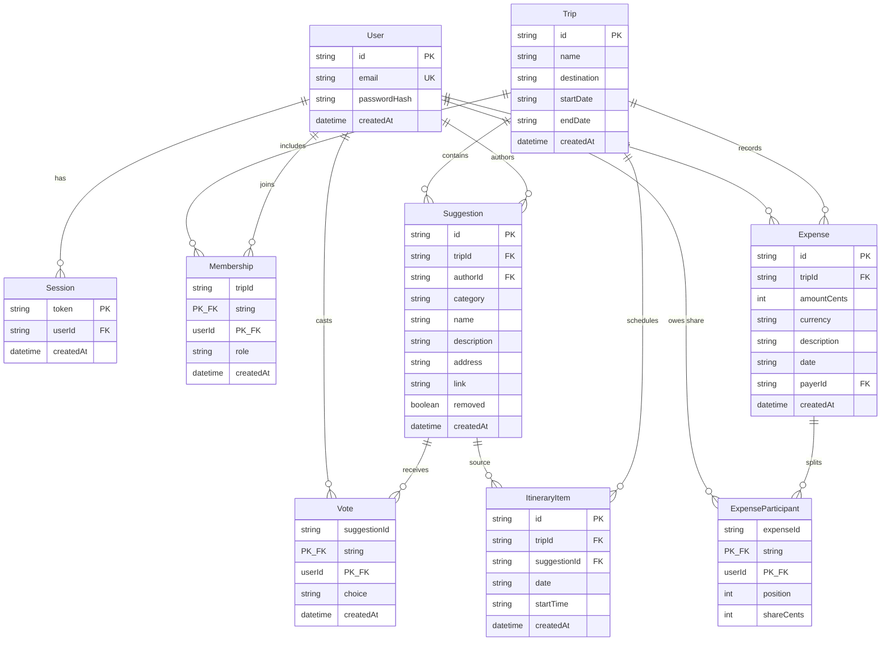
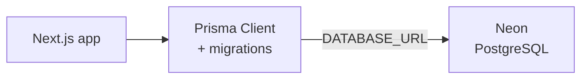

# Tripster database schema

PostgreSQL is the system of record. In production it runs on **Neon**; locally it is a Postgres database named in `DATABASE_URL`. **Prisma** owns the schema file, migrations, and query client (`prisma/schema.prisma` → `lib/generated/prisma`).

This diagram matches the current Prisma models.

## Entity-relationship diagram

## Table notes

| Table | Purpose | Keys / notes |
| --- | --- | --- |
| `User` | Account; email is the username | `email` unique; `passwordHash` never plaintext |
| `Session` | JWT `jti` revocation row | `token` is the session id; cascade delete with user |
| `Trip` | Shared trip workspace | Dates stored as `YYYY-MM-DD` strings |
| `Membership` | Trip access + role | Composite PK `(tripId, userId)`; `role` is `organizer` or `member` |
| `Suggestion` | Lodging / activity / place / restaurant idea | Soft-remove via `removed`; author is a user |
| `Vote` | Preference only (Yes / Maybe / No) | One vote per user per suggestion; **never** creates itinerary rows |
| `ItineraryItem` | Explicit **Add** from a suggestion | Always linked to `suggestionId`; `date` / `startTime` optional (unscheduled) |
| `Expense` | Shared cost on a trip | `amountCents` integer; `payerId` is who paid |
| `ExpenseParticipant` | Who shares the cost | Optional `shareCents` for manual splits; even split fills shares in the service layer |

Cascade deletes follow Prisma: removing a trip or user cleans dependent memberships, suggestions, votes, itinerary items, and expenses.

## Neon + Prisma (how they fit)

- **Neon** hosts PostgreSQL (connection string in `DATABASE_URL`).
- **Prisma** defines tables/relations, applies migrations (`npx prisma migrate deploy`), and runs queries.
- CI and local Vitest use a separate Postgres URL (`DATABASE_URL_TEST`) so tests do not touch production Neon data.

## Source of truth

Edit the schema only through `prisma/schema.prisma` and checked-in migrations under `prisma/migrations/`. Do not hand-edit production tables outside migrations.

## Related docs

- Architecture layers: [`architecture.md`](./architecture.md)
- Setup / env: [`../README.md`](../README.md)
- OpenAPI: [`../openapi/tripster.openapi.json`](../openapi/tripster.openapi.json)
